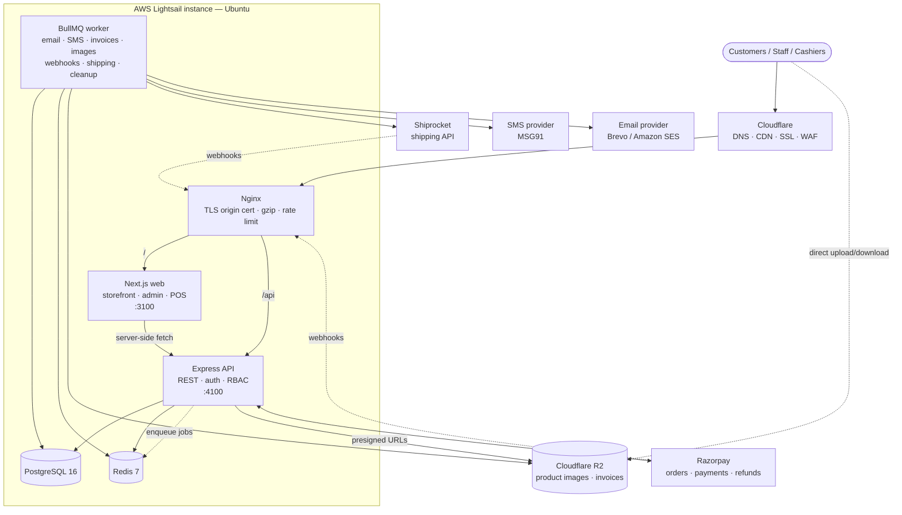

# Architecture

Drift Commerce is a **modular monolith**: one Node.js/TypeScript API, one
Next.js web application (storefront, admin panel and POS), one background
worker, PostgreSQL as the source of truth and Redis for cache, rate limiting
and job queues. Everything runs on a single AWS Lightsail instance at launch and
can be split apart later without changing application code.

## 1. System diagram



Text version of the same picture:

```
Internet → Cloudflare (DNS/CDN/SSL) → Lightsail
                                        ├── Nginx (reverse proxy)
                                        ├── Next.js web  (storefront, /admin, /pos)
                                        ├── Express API  (/api/*)
                                        ├── Worker       (BullMQ jobs)
                                        ├── PostgreSQL
                                        └── Redis
External: Cloudflare R2 · Razorpay · Shiprocket · MSG91 · Brevo/SES
```

## 2. Why this shape

| Decision | Reason |
|---|---|
| Express API separate from Next.js | Clean REST API usable by web, POS and future mobile apps; easy to test with supertest; long-running worker shares the same code. Next.js stays a pure UI layer. |
| Same origin in every environment | Nginx (prod) and Next.js rewrites (dev) serve `/api/*` from the web origin, so auth cookies are first-party, `SameSite=Lax`, and CORS is not needed for the browser. |
| PostgreSQL is the only source of truth | Stock, money, orders and payments are committed in PostgreSQL transactions. Redis only holds data that can be rebuilt (cache, rate-limit counters, queues). |
| Integer paise everywhere | No floating-point money. Razorpay also uses paise. |
| Provider adapters | `PaymentGateway`, `ShippingService`, `SmsService`, `EmailService`, `ObjectStorage` interfaces. Real adapters and mock adapters live in separate files; the mock adapters refuse to start when `NODE_ENV=production`. |
| BullMQ on the same Redis | Retries with backoff, idempotent job ids, scheduled jobs — without new infrastructure. |
| PostgreSQL trigram search | `pg_trgm` GIN indexes on product name and SKU give fast fuzzy search for thousands of products without Elasticsearch. |

## 3. Module breakdown (API)

Each module owns its routes, validation schemas and service (business logic).
Routes never contain business logic; services never touch `req`/`res`.

| Module | Responsibility |
|---|---|
| `auth` | Register, login (password / OTP), refresh-token rotation, logout, email verification, password reset, CSRF token |
| `users` | Profile, addresses, staff user management, role assignment |
| `rbac` | Roles, permissions, role-permission mapping, permission cache |
| `catalog` | Categories (nested), brands, products, variants, options, public listing/search |
| `media` | Presigned R2 uploads, image processing pipeline (WebP/AVIF sizes), ordering, deletion |
| `codes` | QR / EAN-13 / UPC / Code 128 product codes, label sheets, scan lookup |
| `tax` | Tax classes and slab rates, GST split (CGST/SGST vs IGST) |
| `pricing` | Single pricing engine used by cart, checkout and POS: discounts, coupons, tax, shipping, totals |
| `inventory` | Stock levels, ledger, reservations, adjustments, transfers, low-stock alerts |
| `warehouses` | Warehouses and bin locations |
| `suppliers` / `purchasing` | Suppliers, purchase orders, goods receipts (GRN) |
| `cart` / `wishlist` | Persistent cart (guest + user), wishlist |
| `checkout` / `orders` | Quote, order placement with stock reservation, status machine, history |
| `payments` | Razorpay order creation, signature verification, webhooks, reconciliation |
| `refunds` / `returns` | Return requests, inspection (GOOD/DAMAGED/DEFECTIVE), refunds, credit notes |
| `invoices` | Gap-free invoice numbering, immutable snapshots, PDF rendering |
| `shipping` | Shipment creation, tracking sync, webhooks, label generation |
| `notifications` | EMAIL / SMS / IN_APP notifications with retry |
| `coupons` / `discounts` | Coupon rules and automatic price rules |
| `pos` | In-store billing carts, scan-to-cart, POS checkout |
| `reports` / `dashboard` | Aggregates and CSV / Excel / PDF exports |
| `settings` | Typed, validated business settings (tax mode, shipping, return window...) |
| `audit` | Append-only audit log of privileged actions |

## 4. Folder structure

```
drift-commerce/
├── docker-compose.yml            local Postgres, Redis, MinIO (R2 stand-in), Mailpit
├── apps/
│   ├── api/
│   │   ├── prisma/               schema.prisma, migrations/, seed.ts
│   │   ├── src/
│   │   │   ├── server.ts         HTTP entry point
│   │   │   ├── worker.ts         background worker entry point
│   │   │   ├── app.ts            Express app factory (used by tests too)
│   │   │   ├── config/           env validation (zod), constants
│   │   │   ├── database/         Prisma client, transaction helpers, sequences
│   │   │   ├── common/
│   │   │   │   ├── errors/       AppError + centralized error handler
│   │   │   │   ├── middleware/   auth, csrf, rate-limit, idempotency, validation
│   │   │   │   ├── guards/       permission guards
│   │   │   │   └── utils/        money, pagination, crypto, http helpers
│   │   │   ├── jobs/             queues, processors, schedulers
│   │   │   ├── integrations/
│   │   │   │   ├── razorpay/     real + mock gateway
│   │   │   │   ├── r2/           S3-compatible storage
│   │   │   │   ├── shipping/     Shiprocket + mock
│   │   │   │   ├── sms/          MSG91 + console
│   │   │   │   └── email/        Brevo, SES, SMTP + templates
│   │   │   └── modules/<module>/ *.routes.ts · *.service.ts · *.schemas.ts
│   │   └── tests/                vitest + supertest against a real Postgres
│   └── web/
│       └── src/
│           ├── app/
│           │   ├── (store)/      storefront pages
│           │   ├── (auth)/       login, register, forgot password
│           │   ├── account/      profile, addresses, orders, returns, wishlist
│           │   ├── admin/        admin panel (RBAC-aware)
│           │   └── pos/          billing / POS screen
│           ├── components/
│           ├── lib/              API client, auth context, formatters
│           └── hooks/
└── docs: README.md · ARCHITECTURE.md · DATABASE.md · API.md · DEPLOYMENT.md · SECURITY.md
```

## 5. Critical flows

### 5.1 Online checkout and payment

```mermaid
sequenceDiagram
    participant B as Browser
    participant A as API
    participant DB as PostgreSQL
    participant R as Razorpay
    participant W as Worker

    B->>A: POST /api/checkout/quote (cart, address, coupon)
    A->>DB: load prices, discounts, tax rules, stock
    A-->>B: server-calculated totals
    B->>A: POST /api/orders  (Idempotency-Key)
    A->>DB: BEGIN; lock inventory rows (FOR UPDATE);<br/>reserve stock; create order + items + reservation;<br/>coupon redemption; COMMIT
    A-->>B: order (PENDING, payment CREATED)
    B->>A: POST /api/payments/create {orderId}
    A->>R: create Razorpay order (amount from DB)
    A-->>B: razorpay_order_id, key_id
    B->>R: Razorpay Checkout
    R-->>B: payment_id, signature
    B->>A: POST /api/payments/verify
    A->>A: HMAC signature check
    A->>R: fetch payment (status + amount)
    A->>DB: BEGIN; payment PAID (unique payment id);<br/>order CONFIRMED; reserved → sold (ledger SALE); COMMIT
    R-->>A: webhook payment.captured (same idempotent path)
    A->>W: enqueue invoice + email + SMS
```

* The browser never sends prices, tax, discount or totals — only variant ids,
  quantities, address id and coupon code.
* An order is only marked `PAID` after the backend verifies the signature
  **and** confirms the payment status and amount with Razorpay (or receives a
  signed webhook). Both paths call the same idempotent `markOrderPaid()`.
* Unpaid reservations expire after `checkout.reservationTtlMinutes`; a
  scheduled job cancels the order and releases stock.

### 5.2 Overselling protection

Reservation runs inside a transaction:

1. `SELECT ... FROM inventory_levels WHERE (variant_id, warehouse_id) IN (...) ORDER BY id FOR UPDATE`
   — rows are locked in a stable order to avoid deadlocks.
2. Check `on_hand - reserved >= qty` for every line.
3. `reserved += qty`, insert ledger rows (`RESERVATION`), insert `stock_reservations`.

Two concurrent checkouts for the last unit serialize on the row lock; the
second one sees `available = 0` and fails with `409 OUT_OF_STOCK`. A test fires
parallel orders at one unit of stock to prove it.

### 5.3 POS billing

```
Scan (USB scanner = keyboard input, or camera via ZXing)
  → POST /api/pos/carts/:id/scan {code}
  → resolve product_codes.code_value (ACTIVE) or variant SKU
  → check stock in the cart's warehouse (no stock change)
  → add/increment line, return server-priced cart
Complete sale (Idempotency-Key)
  → transaction: lock stock in the POS warehouse, create order (channel POS)
  → CASH / UPI_MANUAL: payment recorded as PAID by the authenticated cashier,
    stock deducted (ledger SALE), invoice issued
  → RAZORPAY: same as online — stock reserved until the payment is verified
```

Scanning never changes stock. Out-of-stock items can only be added by a user
with `pos.override_stock`, and every override is audit-logged.

### 5.4 Returns

`REQUESTED → APPROVED → (PICKUP_SCHEDULED) → RECEIVED → REFUNDED → CLOSED`.
On receipt each item is inspected: `GOOD` units go back to `on_hand`
(ledger `RETURN`), `DAMAGED`/`DEFECTIVE` units go to the `damaged` bucket
(ledger `DAMAGE`). Refunds call Razorpay (or are recorded for cash) and issue
a credit note against the original invoice.

## 6. Third-party integration plan

| Concern | Production adapter | Local / test adapter | Selected by |
|---|---|---|---|
| Payments | Razorpay (`razorpay` SDK + HMAC verification + webhooks) | `MockPaymentGateway`: simulated orders/payments, signed with a local secret so the same verification code runs | `PAYMENT_PROVIDER=razorpay\|mock` |
| Object storage | Cloudflare R2 via S3 API (`@aws-sdk/client-s3`, presigned PUT) | MinIO container (same S3 code path) | `R2_*` variables |
| Email | Brevo HTTP API or Amazon SES v2 | SMTP → Mailpit container | `EMAIL_PROVIDER=brevo\|ses\|smtp` |
| SMS / OTP | MSG91 (DLT template ids) | `ConsoleSmsProvider` (logs masked messages) | `SMS_PROVIDER=msg91\|console` |
| Shipping | Shiprocket (token auth, serviceability rates, AWB, pickup, label, tracking, webhooks) | `MockShippingProvider` (deterministic AWB, simulated tracking) | `SHIPPING_PROVIDER=shiprocket\|mock` |

Mock adapters live in `integrations/*/mock*.ts`, are never imported by
business logic directly, and throw at startup if `NODE_ENV=production`.

## 7. Configurable business rules

These rules affect money, stock or tax. They are **settings**, not code, and
the seeded defaults must be confirmed by the business before go-live
(Admin → Settings).

| Setting | Seed default | Notes |
|---|---|---|
| `store.legalName`, `store.gstin`, `store.stateCode`, address | placeholders | Printed on invoices; `stateCode` decides CGST+SGST vs IGST |
| `pricing.pricesIncludeTax` | `true` | Whether catalog selling prices are GST-inclusive |
| `pricing.roundGrandTotal` | `false` | Round order total to the nearest rupee (difference stored as `round_off`) |
| Tax classes / slab rates | example classes only | Rates must be confirmed by your accountant; supports price slabs and effective dates |
| `shipping.mode` | `FLAT` | `FLAT` or `PROVIDER_RATES` |
| `shipping.flatRate`, `shipping.freeShippingThreshold` | ₹49 / ₹999 | Placeholder amounts |
| `shipping.chargeTaxable`, `shipping.taxRateBps` | `false` / 0 | Whether GST applies on the shipping charge |
| `checkout.reservationTtlMinutes` | 30 | How long unpaid orders hold stock |
| `checkout.allowGuestCheckout` | `false` | |
| `returns.windowDays` | 7 | Days after delivery a return may be requested |
| `returns.autoRestockGood` | `true` | GOOD items return to sellable stock on receipt |
| `refunds.allowPartial` | `true` | Partial refunds |
| `pos.maxManualDiscountBps` | 1000 (10%) | Cap for cashier manual discounts |
| `coupons.allowWithAutomaticDiscounts` | `true` | Whether coupons apply on top of automatic discounts |
| `invoice.prefix`, `invoice.creditNotePrefix` | `INV`, `CN` | Numbering restarts every financial year (April–March) |
| `barcodes.ean13Prefix` | `200` | Internal-use GS1 range; replace with your GS1 company prefix if you own one |
| `inventory.defaultLowStockThreshold` | 5 | |

## 8. Development phases

| Phase | Scope |
|---|---|
| 1 | Project setup, database, authentication, users, roles, permissions |
| 2 | Products, categories, brands, variants, product images, R2 |
| 3 | Inventory, warehouses, suppliers, purchase orders |
| 4 | Customer storefront, cart, checkout |
| 5 | Orders, Razorpay payments, payment webhooks |
| 6 | Billing, invoices, refunds, returns |
| 7 | Shipping |
| 8 | SMS / email notifications |
| 9 | Admin dashboard, reports, audit logs, QR/barcode + POS |
| 10 | Testing, performance, security review, deployment |

Every phase ends with: tests, `tsc --noEmit`, lint, migration check and an API
smoke test.

## 9. Scaling plan

| Stage | Trigger | Change | Code impact |
|---|---|---|---|
| 1 | Launch | One Lightsail instance | — |
| 2 | DB CPU/IO contention | Move PostgreSQL to Lightsail managed DB / RDS | `DATABASE_URL` only |
| 3 | Redis memory pressure | Separate Redis | `REDIS_URL` only |
| 4 | API CPU saturation | Separate API and worker instances | Process placement only |
| 5 | Single API node insufficient | Load balancer + N API instances | Stateless API already (sessions in DB, cache in Redis) |
| 6 | Operational load | Managed services where justified | Config only |
