# Database

PostgreSQL 16, managed with Prisma migrations. The authoritative definition is
[`apps/api/prisma/schema.prisma`](apps/api/prisma/schema.prisma); this document
explains the design.

## Conventions

* `snake_case` tables and columns, UUID primary keys.
* **Money is integer paise** (`79900` = ₹799.00). **Rates are basis points**
  (`1800` = 18%). No floating point anywhere in money paths.
* `created_at` / `updated_at` on every mutable table.
* Business documents (orders, invoices, credit notes) store **snapshots**
  (names, SKUs, prices, tax split, addresses) so catalog edits never rewrite
  history.
* Extensions: `pg_trgm` (fuzzy search), `citext` (case-insensitive email and
  coupon codes).

## Entity relationship diagram (core)

```mermaid
erDiagram
    users ||--o| user_profiles : has
    users ||--o{ addresses : has
    users ||--o{ user_sessions : has
    users ||--o{ user_roles : has
    roles ||--o{ user_roles : grants
    roles ||--o{ role_permissions : has
    permissions ||--o{ role_permissions : in

    categories ||--o{ categories : parent_of
    categories ||--o{ products : contains
    brands ||--o{ products : makes
    tax_classes ||--o{ tax_rates : has
    tax_classes ||--o{ products : taxes
    products ||--o{ product_options : has
    product_options ||--o{ product_option_values : has
    products ||--|{ product_variants : has
    product_variants ||--o{ variant_option_values : has
    products ||--o{ product_images : has
    product_variants ||--o{ product_codes : identified_by

    warehouses ||--o{ warehouse_locations : has
    product_variants ||--o{ inventory_levels : stocked_as
    warehouses ||--o{ inventory_levels : holds
    product_variants ||--o{ inventory_transactions : ledger
    warehouses ||--o{ inventory_transactions : ledger
    orders ||--o{ stock_reservations : reserves

    suppliers ||--o{ purchase_orders : receives
    purchase_orders ||--|{ purchase_order_items : has
    purchase_orders ||--o{ goods_receipts : received_by
    goods_receipts ||--|{ goods_receipt_items : has

    users ||--o| carts : owns
    carts ||--o{ cart_items : has
    users ||--o{ orders : places
    orders ||--|{ order_items : has
    orders ||--o{ order_status_history : logs
    orders ||--o{ payments : paid_by
    payments ||--o{ refunds : refunded_by
    orders ||--o| invoices : billed_by
    invoices ||--o{ credit_notes : credited_by
    orders ||--o{ shipments : shipped_by
    shipments ||--o{ shipment_events : tracks
    orders ||--o{ return_requests : returned_by
    return_requests ||--|{ return_items : has
    coupons ||--o{ coupon_redemptions : used_in
    orders ||--o| coupon_redemptions : uses
    warehouses ||--o{ pos_carts : bills_from
    pos_carts ||--o{ pos_cart_items : has
```



The product identification chain required for scanning:

```
products (P100)
  └─ product_variants (V200, sku TSH-RED-M-001)        ← SKU is the business identifier
       ├─ product_codes  QR  Q7K2M9XQ1P → V200         ← codes resolve to exactly one variant
       ├─ product_codes  EAN 2000000000015 → V200
       ├─ inventory_levels  V200 @ WH-001 = 25          ← quantity lives here, never in the code
       ├─ order_items  V200 × 1
       └─ inventory_transactions  V200 SALE -1 (25 → 24)
```

## Table groups

| Group | Tables |
|---|---|
| Identity | `users`, `user_profiles`, `addresses`, `user_sessions`, `login_attempts`, `verification_tokens`, `otp_codes` |
| RBAC | `roles`, `permissions`, `role_permissions`, `user_roles` |
| Catalog | `categories`, `brands`, `tax_classes`, `tax_rates`, `products`, `product_options`, `product_option_values`, `product_variants`, `variant_option_values`, `product_images`, `product_codes` |
| Inventory | `warehouses`, `warehouse_locations`, `inventory_levels`, `inventory_transactions`, `stock_reservations`, `stock_adjustments`, `stock_adjustment_items`, `stock_transfers`, `stock_transfer_items` |
| Purchasing | `suppliers`, `purchase_orders`, `purchase_order_items`, `goods_receipts`, `goods_receipt_items` |
| Commerce | `carts`, `cart_items`, `wishlist_items`, `product_reviews`, `coupons`, `coupon_products`, `coupon_categories`, `coupon_redemptions`, `discounts`, `discount_targets` |
| Orders | `orders`, `order_items`, `order_status_history` |
| Payments | `payments`, `refunds`, `webhook_events` |
| Billing | `invoices`, `credit_notes`, `document_sequences` |
| Fulfilment | `shipments`, `shipment_events`, `return_requests`, `return_items` |
| POS | `pos_carts`, `pos_cart_items` |
| Messaging | `notifications`, `sms_logs`, `email_logs` |
| Platform | `audit_logs`, `settings`, `idempotency_keys` |

## Inventory model

`inventory_levels` holds one row per (variant, warehouse) with four buckets:

| Column | Meaning |
|---|---|
| `on_hand` | Physical sellable units in the warehouse, **including** reserved units |
| `reserved` | Units held for unpaid / unfulfilled orders |
| `damaged` | Damaged or defective units (not sellable) |
| `returned` | Returned units awaiting inspection |

`available = on_hand - reserved`. Database `CHECK` constraints keep
`reserved`, `damaged` and `returned` non-negative and `reserved <= on_hand`
(overrides that sell below zero are an explicit, permissioned exception).

Every change to any bucket inserts a row into `inventory_transactions`
(`type`, `bucket`, signed `quantity`, `balance_before`, `balance_after`,
reference, user, notes). The ledger is append-only; a database trigger rejects
`UPDATE` and `DELETE`.

Movement types: `PURCHASE`, `SALE`, `RETURN`, `REFUND`, `DAMAGE`,
`ADJUSTMENT`, `TRANSFER_IN`, `TRANSFER_OUT`, `STOCK_CORRECTION`, plus
`RESERVATION` / `RESERVATION_RELEASE` for the reserved bucket.

## Concurrency and consistency

| Operation | Mechanism |
|---|---|
| Stock reservation / deduction | Transaction + `SELECT ... FOR UPDATE` on `inventory_levels` rows, locked in id order |
| Document numbers (orders, invoices, credit notes, POs, GRNs) | `document_sequences` row locked `FOR UPDATE` inside the business transaction → gap-free per period |
| Double "Pay now" / retries | `Idempotency-Key` header stored in `idempotency_keys` (unique `scope, key`) + `orders.idempotency_key UNIQUE` |
| Duplicate payment webhooks | `webhook_events (provider, event_id) UNIQUE`, `payments.razorpay_payment_id UNIQUE`, state-machine guards |
| Duplicate refunds | `refunds.idempotency_key UNIQUE`, `refunds.razorpay_refund_id UNIQUE` |
| Coupon usage limits | `coupons` row locked `FOR UPDATE` while counting redemptions |

## Immutability

* `invoices`: a trigger blocks changes to any financial column after insert;
  only `status`, `cancelled_at` and `pdf_key` may change.
* `credit_notes`, `inventory_transactions`, `audit_logs`: insert-only
  (trigger rejects `UPDATE`/`DELETE`).

## Index strategy

| Need | Index |
|---|---|
| SKU lookup / scan | `product_variants.sku UNIQUE`, `product_codes.code_value UNIQUE`, trigram on SKU |
| Product search | `pg_trgm` GIN on `products.name` and `product_variants.sku`; GIN on `products.tags` |
| Listing & filters | `(category_id, status)`, `brand_id`, `selling_price`, `(status, created_at)` |
| Slugs | `products.slug`, `categories.slug`, `brands.slug` UNIQUE |
| Users | `users.email` (citext) UNIQUE, `users.phone` UNIQUE |
| Orders | `order_number UNIQUE`, `(user_id, created_at)`, `(status, created_at)`, `payment_status` |
| Payments | `razorpay_order_id UNIQUE`, `razorpay_payment_id UNIQUE` |
| Shipping | `awb UNIQUE`, `provider_shipment_id` |
| Ledger | `(variant_id, warehouse_id, created_at)`, `(reference_type, reference_id)` |
| Reservations expiry | `(status, expires_at)` |

All list endpoints are paginated (default 20, max 100) and select only the
columns they render.

## Migrations

* Development: `npm run db:migrate` (`prisma migrate dev`).
* Production: `prisma migrate deploy` only — never `migrate dev`, `db push` or
  `migrate reset` against production. Migrations are additive; destructive
  changes are done in two releases (stop using the column, then drop it).
* Raw SQL that Prisma cannot express (CHECK constraints, immutability
  triggers) lives in the migration files themselves.

### Hosted on Supabase

The schema uses only standard PostgreSQL plus the `citext` and `pg_trgm` extensions, so it runs unchanged on Supabase (PostgreSQL 17). Apply migrations there with `npm run db:deploy --workspace apps/api`, never with `migrate dev`. Every table has row level security enabled there with no policy, and Supabase's API roles hold no privileges (see `scripts/db-lockdown.ts`): the tables are for the application only. The application's role owns the tables, so the policies do not apply to it.

## Seed data

`npm run db:seed` creates permissions, the system roles, a super admin, a
default warehouse, example tax classes, settings defaults and a demo catalog
(development only — the demo catalog is skipped when `NODE_ENV=production`).
